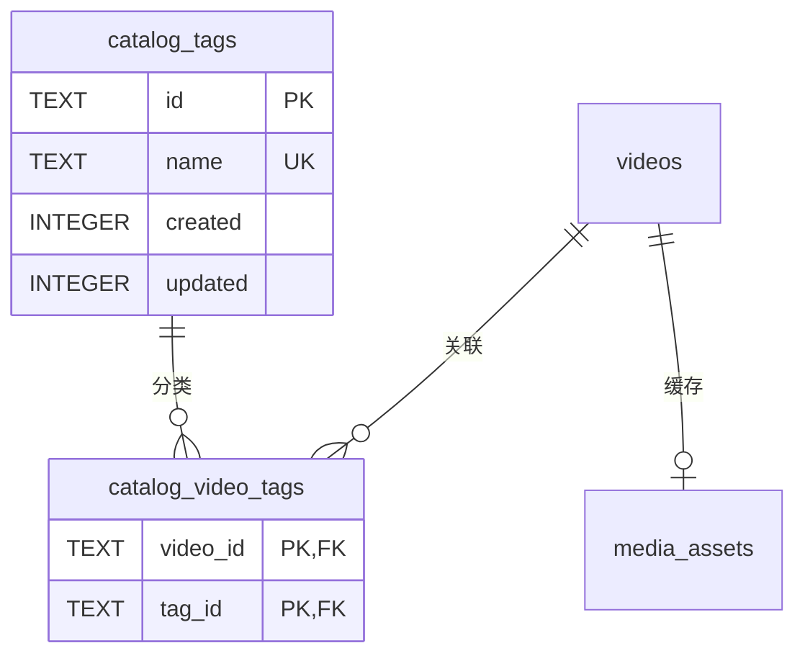
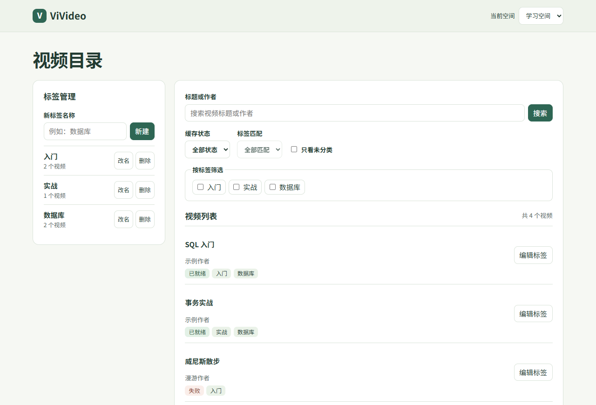
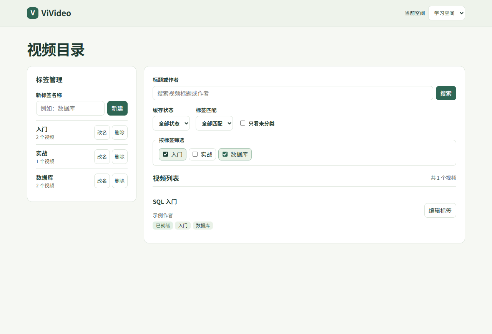

# Part A：视频目录与标签检索验收

## 数据关系和约束



- 两张分类表存放在当前空间的 SQLite 数据库中。学习和漫游各自读写自己的数据库，同名标签可以分别创建。
- 标签 ID 是 UUID 字符串。名称去掉两端空白后须为 1～30 个字符，并按 SQLite 默认的大小写敏感规则判重。标签名称含空字符时返回 422。创建和修改时间由服务端记录为 UTC Unix 毫秒。
- 关联表以视频 ID 和标签 ID 组成复合主键，两列都设有外键。一个视频最多关联 20 个标签。删除标签时级联删除对应的关联行。
- 目录从已有的 `videos LEFT JOIN media_assets` 读取元数据。没有资产记录时显示「未缓存」，缺标题时显示视频 ID，缺少有效时长时返回 `null`。标记为 `evicted` 的视频在目录及标签计数中隐藏。

## 组合筛选和计数

「全部匹配」示例使用两个标签。运行时按去重后的标签 ID 个数生成占位符，绑定两个 ID 和目标数量 2。

```sql
SELECT v.id
FROM videos v
LEFT JOIN media_assets a ON a.video_id = v.id
WHERE COALESCE(a.state, 'missing') <> 'evicted'
  AND v.id IN (
      SELECT video_id
      FROM catalog_video_tags
      WHERE tag_id IN (?, ?)
      GROUP BY video_id
      HAVING COUNT(DISTINCT tag_id) = ?
  )
ORDER BY v.created DESC, v.id ASC
LIMIT ? OFFSET ?;
```

「任一匹配」使用以下子查询。外层的 `IN` 判断视频是否命中，即使一个视频匹配多个标签也只返回一行。

```sql
AND v.id IN (
    SELECT video_id
    FROM catalog_video_tags
    WHERE tag_id IN (?, ?)
)
```

未分类用 `NOT EXISTS` 检查关联，关键词用 `instr()` 匹配展示标题或作者的字面子串。关键词、标签和缓存状态条件用 `AND` 组合。目录总数用相同条件执行 `COUNT(*)`，外层每个视频至多一行。分页后再用一条查询加载本页所有视频的完整标签。计数、分页和标签读取共享同一个读事务。

标签数量先对可见关联按标签分组计数，再与标签表做 `LEFT JOIN`。这样仍会返回没有关联的标签，数量为 0。

## 整组保存事务

`PUT /api/spaces/{space_id}/video-catalog/{video_id}/tags` 开启 `BEGIN IMMEDIATE` 后，在同一连接验证视频及标签归属，删除旧关联，插入去重后的新关联并读回完整结果。空集合会清除全部关联。任何一步失败都会回滚。验收测试使用临时 SQLite 触发器让插入失败，确认旧标签完整保留。

## 固定样例结果

| 操作 | 实际结果 |
|---|---|
| 打开学习空间目录 | a、b、c、d，共 4 条。已清理的 e 隐藏 |
| 查看标签数量 | 数据库 2，入门 2，实战 1 |
| 数据库和入门全部匹配 | a |
| 数据库和入门任一匹配 | a、b、c，共 3 条 |
| 仅查看未分类 | d，显示视频 ID 和「未缓存」 |
| 数据库和已就绪 | a、b |
| 关键词「事务」和数据库 | b |
| 清空 a 的标签后查看未分类 | a、d |

## 查询计划

在固定样例上使用 SQLite 3.45.3 执行 `EXPLAIN QUERY PLAN`。两个标签的分页查询均出现以下索引访问。

```
SEARCH v USING INDEX sqlite_autoindex_videos_1 (id=?)
SEARCH catalog_video_tags USING COVERING INDEX idx_catalog_video_tags_tag (tag_id=?)
SEARCH a USING INDEX sqlite_autoindex_media_assets_1 (video_id=?) LEFT-JOIN
```

「全部匹配」多了一步 `USE TEMP B-TREE FOR GROUP BY`，两个模式都使用 `USE TEMP B-TREE FOR ORDER BY` 排序。按标签过滤时，SQLite 选择先通过标签索引找到视频，再按视频主键查表。无标签筛选的分页查询使用 `SCAN v USING COVERING INDEX idx_catalog_videos_created`，按目录排序顺序扫描视频。标题和作者的字面子串查询由 `instr()` 逐行匹配。

## 如何复验

在已安装依赖的环境中，从仓库根目录运行。Part A 共 13 项自动化测试，全部通过。

```sh
python -m pip install -e .
python -m unittest discover -s tests -p 'test_catalog.py' -v
```

可以在 PowerShell 中用以下命令启动带固定样例的独立页面。样例写入临时目录。

```powershell
$env:VIVIDEO_DATA_DIR = Join-Path ([IO.Path]::GetTempPath()) ('vivideo-part-a-' + [guid]::NewGuid())
$env:PYTHONPATH = 'python;tests'
python -c "from test_catalog import seed_catalog; seed_catalog()"
python -m uvicorn vivideo.app:app --host 127.0.0.1 --port 8001
```

打开 [视频目录](http://127.0.0.1:8001/static/part-a.html)，勾选「数据库」和「入门」。切换「全部匹配」与「任一匹配」，核对分别显示 1 条和 3 条。新建一个标签，给「SQL 入门」添加它并保存，核对计数变成 1。刷新页面核对标签仍在，再清空勾选并保存。切到漫游空间可验证独立数据。

浏览器验收还覆盖了标签改名、删除当前筛选标签、分页、保存失败后保留勾选，以及延迟响应下切换筛选和空间。Windows 上运行完整测试时，Part A 分支和原主分支均有相同的 2 项失败、7 项错误和 4 项跳过。该比对在相同依赖和系统环境下完成。

## 页面截图

完整目录及标签计数



选择「数据库」与「入门」并使用全部匹配


