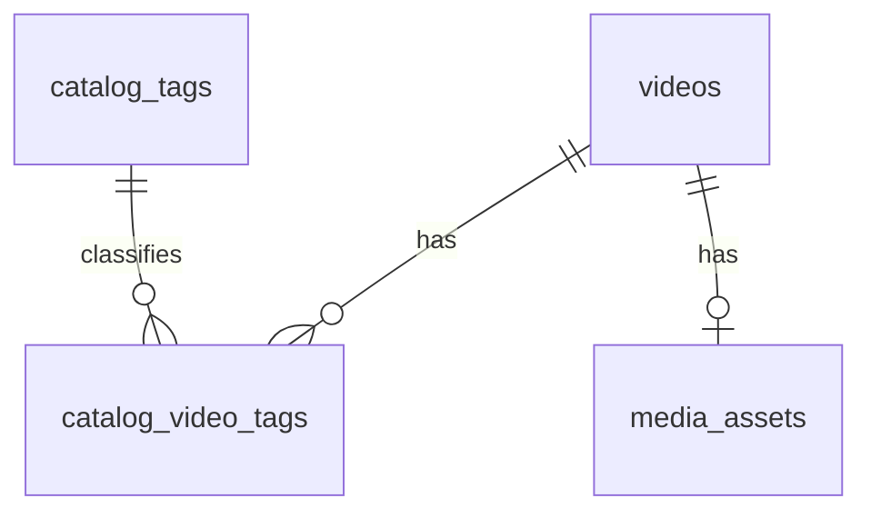

# Part A：视频目录与标签检索

状态：待实现的需求清单。本文的新表、接口和页面目前尚未实现。

目标：为当前空间已有的视频建立可维护的内容分类，用户可以给视频设置标签，并按关键词、多个标签及缓存状态查找视频。现有收藏功能继续使用，本模块不再开发收藏夹。

[开发指南](../dev.md) · [Part B](partB.md) · [Part C](partC.md)

## 1. 为什么需要这个模块

目前的数据库已经保存了会话、消息、记忆、观看记录、下载计划、任务和缓存资产。视频主要通过搜索关键词进入数据库，元数据保存在 `media_assets` 中；本地目录支持简单文本搜索，但没有内容标签与视频之间的结构化关系。

随着同一空间积累的视频变多，用户需要回答“有哪些入门数据库视频”“同时属于 SQL 和实战的有哪些”“哪些已有视频还没有分类”等问题。标签提供可复用的分类维度；多个视频可以具有同一个标签，一个视频也可以具有多个标签。

本模块的数据库目标是：通过两张新表表达多对多关系，用外键、唯一约束、事务和关联查询保证分类正确，并实现有明确语义的组合检索。

视频标签描述内容，例如“数据库”“入门”“实战”。它与偏好页的长期兴趣 `space_traits` 分开维护，不自动写入用户画像，也不自动传给模型。

## 2. 任务边界

| 必须实现 | 本次不要求 |
|---|---|
| 内容标签的新建、列表、改名、删除 | 账号、权限、跨空间分类 |
| 给已有视频设置多个标签或清空标签 | 自动打标签、修改模型/MCP、语义向量搜索 |
| 视频目录分页、关键词、标签、缓存状态筛选 | 重写现有收藏、下载、缓存淘汰和播放器 |
| 多标签“任一匹配”“全部匹配”、查找未分类视频 | 分类树、标签同义词、批量编辑多个视频 |
| 标签关联数量、空间隔离、数据库持久化 | 把视频标题、作者重新拆成更多实体表 |

用户在独立页面中完成以下操作即可验收：创建“数据库”“入门”两个标签 → 给已有视频勾选标签 → 使用全部匹配查到该视频 → 修改或清空标签 → 删除标签。

视频来源与缓存状态以现有数据为准。本模块不创建视频、不下载视频、不删除视频或文件；标签改动也不改变缓存的“保留”状态。

## 3. 先阅读这些代码

| 位置 | 要理解的内容 |
|---|---|
| `storage.py`：`database(space)` | 如何打开当前空间数据库、提交或回滚事务 |
| `storage.py`：`videos` 表 | 视频 ID、唯一 URL、搜索词和创建时间 |
| `library_schema.py`：`media_assets` 表 | 标题、作者、时长、缓存状态的现有归属 |
| `library.py`：`query_videos()`、`remove_asset()` | 已清理条目用 `evicted` 标记并从用户列表隐藏 |
| `state_api.py`、`app.py` | 参数校验、错误处理、路由与静态页面接入 |

以上 Python 文件均位于 `python/vivideo/`。继续使用 SQLite 和原生 HTML/CSS/JavaScript，不引入新数据库、ORM 或前端框架。

新增数据放在每个空间已有的 `space.db`，通过 `storage.database(space)` 访问。学习和漫游各自拥有自己的标签与关联，不额外增加 `space_id` 列，也不打开另一个空间的连接来合并查询。

## 4. 文件归属与接入方式

| 文件 | 内容 |
|---|---|
| `python/vivideo/catalog_store.py` | 建表、参数化 SQL、关联维护和目录查询 |
| `python/vivideo/catalog_api.py` | 请求校验和接口，导出 `router` |
| `python/vivideo/static/part-a.html` | 视频目录与标签管理页面 |
| `python/vivideo/static/part-a.js` | 页面交互与接口请求 |
| `python/vivideo/static/part-a.css` | 页面样式 |
| `tests/test_catalog.py` | 本模块测试 |

在 `app.py` 增加 `from .catalog_api import router as catalog_router` 与 `app.include_router(catalog_router)`，保留其他注册。其他公共文件不需要修改，不改写现有 `/videos` 或 `/local-videos` 接口。

页面地址 `/static/part-a.html`，只加载自己的 JS/CSS，不加载现有 `app.js`。它不依赖 Part B、C。最终主页面入口由负责人统一接入。

## 5. 数据表：新增两张即可

关系如下；`videos` 和 `media_assets` 已存在，不能重复建立资源副本：



按以下 DDL 实现，UUID 用字符串，时间由服务端生成，为 UTC Unix 毫秒整数：

```sql
CREATE TABLE IF NOT EXISTS catalog_tags (
    id TEXT PRIMARY KEY,
    name TEXT NOT NULL UNIQUE CHECK(length(name) BETWEEN 1 AND 30),
    created INTEGER NOT NULL,
    updated INTEGER NOT NULL
);

CREATE TABLE IF NOT EXISTS catalog_video_tags (
    video_id TEXT NOT NULL REFERENCES videos(id) ON DELETE CASCADE,
    tag_id TEXT NOT NULL REFERENCES catalog_tags(id) ON DELETE CASCADE,
    PRIMARY KEY(video_id, tag_id)
);

CREATE INDEX IF NOT EXISTS idx_catalog_video_tags_tag
    ON catalog_video_tags(tag_id, video_id);

CREATE INDEX IF NOT EXISTS idx_catalog_videos_created
    ON videos(created DESC, id);
```

提供 `ensure_schema(db)`，用逐条 `db.execute()` 执行 DDL，在本模块每次业务读写前调用，允许重复执行。不在业务事务中调用 `executescript()`，本阶段不要求通用迁移框架。现有连接已经启用外键。

名称先用 Python `strip()`，再校验长度 1～30。按 SQLite 默认大小写敏感规则判重；同一空间可分别存在 `SQL` 和 `sql`。不同空间允许同名。数据库 `UNIQUE` 必须保留，防止并发创建重复标签。

每个视频最多关联 20 个标签。同一个关联只能有一行，主键负责去重。标签改名只更新 `catalog_tags`，所有关联立即显示新名称。删除标签级联删除关联，不删除视频、笔记或观看记录。

## 6. 视频目录与清理规则

目录以 `videos LEFT JOIN media_assets` 为基础，输出以下字段：

| 字段 | 来源或默认值 |
|---|---|
| `video_id`、`url`、`created` | `videos.id`、`url`、`created` |
| `title` | `COALESCE(NULLIF(media_assets.title, ''), videos.id)` |
| `author` | `COALESCE(media_assets.author, '')` |
| `duration_seconds` | `media_assets.duration > 0` 时为实际值，否则为 `null` |
| `cache_state` | `COALESCE(media_assets.state, 'missing')` |
| `tags` | 本视频完整标签数组，按 `name ASC, id ASC` 排序 |

**`cache_state='evicted'` 的视频始终隐藏**，即使它带有标签或关键词命中也不能重新出现。标签列表中的 `video_count` 同样不统计已清理视频。针对已清理视频设置标签返回 `404`。

清理流程可能保留内部视频和标签关联，Part A 不负责改动这些状态。若原下载流程以后使该视频重新变成非 `evicted`，原分类可以重新可见；不能因为打开目录页就恢复视频或触发下载。

缺少 `media_assets` 行的视频视为 `missing`，允许显示和分类；其他可见状态为 `queued`、`downloading`、`processing`、`ready`、`failed`。目录查询不承诺文件一定可播放，是否能播放仍由已有播放接口判断。

## 7. HTTP 接口合同

前缀 `/api/spaces/{space_id}`，空间类型使用现有 `Space`，仅允许 `learning`、`roaming`。标签 ID 为 UUID，视频 ID 为长度 1～100 的非空字符串，不是 UUID。

| 方法与相对路径 | 请求 | 成功响应 |
|---|---|---|
| `GET /video-tags` | 无 | `200`，全部标签及其可见视频数量 |
| `POST /video-tags` | `{"name":"数据库"}` | `201`，标签对象，`video_count=0` |
| `PATCH /video-tags/{tag_id}` | `{"name":"关系数据库"}` | `200`，更新后的标签对象 |
| `DELETE /video-tags/{tag_id}` | 无 | `204`，无响应体 |
| `GET /video-catalog` | 见下表 | `200`，分页目录 |
| `PUT /video-catalog/{video_id}/tags` | `{"tag_ids":["标签UUID", "另一个标签UUID"]}` | `200`，该视频的完整标签集合 |

标签列表格式为 `{"items":[...],"total":1}`，按 `name ASC, id ASC` 排序，不分页。单个标签格式如下：

```json
{"id":"11111111-1111-4111-8111-111111111111","name":"数据库","created":1704038400000,"updated":1704038400000,"video_count":2}
```

目录查询参数：

| 参数 | 默认值与规则 |
|---|---|
| `q` | 空串，去两端空白，最长 100 字；标题或作者的字面子串，大小写敏感 |
| `tag_ids` | 空列表；重复查询参数，例如 `?tag_ids=UUID1&tag_ids=UUID2`，最多传 20 项，解析后去重 |
| `tag_mode` | `all`；只允许 `all` 或 `any` |
| `untagged` | `false`；为 `true` 时只查没有任何标签的视频，不能同时传非空 `tag_ids` |
| `cache_state` | 省略表示全部可见状态；可选 `missing/queued/downloading/processing/ready/failed`，不接受 `evicted` |
| `limit` | 20，范围 1～100 |
| `offset` | 0，大于等于 0 |

各筛选条件之间使用 AND。`all` 表示视频同时具备选中的每个标签，允许再有其他标签；`any` 表示至少具备其中一个。没有传标签时忽略 `tag_mode`。格式正确但不属于当前空间的标签 ID 返回 `404`；非法格式返回 `422`。

按 `created DESC, video_id ASC` 排序，过滤后计数再分页，`total` 是不同视频的数量。单个视频不能因有多个标签而在结果里重复出现；其 `tags` 必须包含全部标签，而非只返回命中的标签。

目录响应示例：

```json
{
  "items":[
    {"video_id":"demo-video-a","title":"SQL 入门","url":"https://example.com/video/a","author":"示例作者","duration_seconds":100,"cache_state":"ready","created":1704038400000,"tags":[{"id":"11111111-1111-4111-8111-111111111111","name":"数据库"}]}
  ],
  "total":1,"limit":20,"offset":0
}
```

设置标签使用**替换整个集合**语义，空数组代表清空，重复 ID 去重后处理。响应为 `{"video_id":"demo-video-a","tags":[{"id":"…","name":"数据库"}]}`。请求中的原始标签列表最多 20 项；未知字段使用 Pydantic `ConfigDict(extra='forbid')` 拒绝。

## 8. 事务与错误规则

设置标签按以下顺序执行，使用同一个数据库连接：

1. 初始化表后执行 `BEGIN IMMEDIATE`。
2. 确认视频属于当前空间且未清理；确认所有标签都属于当前空间。
3. 删除该视频原有的 `catalog_video_tags` 关系。
4. 插入去重后的完整标签集合；空集合不插入。
5. 查询完整标签后提交，任一步失败则整体回滚。

相同集合重复保存的最终结果相同，不产生重复行；并发保存时以最后成功提交的完整集合为准，本阶段不实现分类编辑的版本冲突检查。

标签列表与计数、目录总数与分页条目及其标签，各自在同一个只读事务中完成，防止一份响应内数字不一致。先初始化表与索引，再执行 `BEGIN`，业务查询阶段不写其他数据。

| 场景 | 结果 |
|---|---|
| 标签名称为空、超长、UUID 或查询参数非法 | `422` |
| 标签新建或改名与其他标签重名 | `409`，原记录保持不变 |
| 改名或删除的标签不存在于当前空间 | `404` |
| 设置标签的视频不存在或已清理 | `404` |
| 标签集合中任一 ID 不属于当前空间 | `404`，原有分类完全保留 |
| 标签 ID 重复 | 去重处理，成功 |
| 清空标签集合 | 成功，视频变为未分类 |
| 标签改为自己的原名称 | 成功 |

唯一约束异常只在可识别的重名场景转换为 `409`，不要把所有数据库错误都吞掉。业务错误使用 `StateError`，响应为 `{"detail":"错误说明"}`；FastAPI 参数校验沿用 `422`。测试若使用临时 `FastAPI()`，也需注册与 `app.py` 相同的 `StateError` 处理器。

## 9. 查询实现提示

不要把标签拼成视频表里的逗号字符串或 JSON，也不要把全部视频读回 Python 后筛选。筛选、计数和分页用 SQL 完成。动态 SQL 只能拼固定子句和与参数数量对应的 `?` 占位符，所有用户输入都绑定传参。

以下为两个已知标签的全部匹配，实际代码按去重后的数量生成占位符和计数：

```sql
SELECT v.id
FROM videos v
LEFT JOIN media_assets a ON a.video_id = v.id
WHERE COALESCE(a.state, 'missing') <> 'evicted'
  AND v.id IN (
      SELECT video_id
      FROM catalog_video_tags
      WHERE tag_id IN (?, ?)
      GROUP BY video_id
      HAVING COUNT(DISTINCT tag_id) = ?
  )
ORDER BY v.created DESC, v.id ASC;
```

任一匹配可使用以下子查询；即使命中两个标签，也只返回一个视频：

```sql
SELECT v.id
FROM videos v
LEFT JOIN media_assets a ON a.video_id = v.id
WHERE COALESCE(a.state, 'missing') <> 'evicted'
  AND v.id IN (
      SELECT video_id FROM catalog_video_tags WHERE tag_id IN (?, ?)
  )
ORDER BY v.created DESC, v.id ASC;
```

未分类使用 `NOT EXISTS (SELECT 1 FROM catalog_video_tags t WHERE t.video_id=v.id)`。标签数量统计必须保留数量为 0 的标签，并排除已清理视频，可以先聚合可见关联再 `LEFT JOIN` 标签表。

目录分页查询完成后，使用一条批量关联查询读取本页所有视频的全部标签，再在 Python 中组装数组，不要对每个视频单独查询一次。没有结果时跳过批量查询，不生成空的 `IN ()`。

## 10. 页面需求

- 顶部提供空间选择器、标签新建/改名/删除区，标签旁显示可见视频数量。删除前页面内确认。
- 提供标题/作者搜索框、多标签勾选、“全部/任一”选择、“只看未分类”和缓存状态筛选。
- 列表展示标题、作者、缓存状态、已有标签和“编辑标签”按钮；标题缺失时展示视频 ID。
- 编辑标签用勾选框选择最多 20 个，提供保存和清空；保存成功后刷新目录及标签数量。
- 标签删除、改名后更新筛选项；删除了正在筛选的标签时移除该条件，避免继续请求失效 ID。
- 标签多选与“只看未分类”不能同时生效，界面联动清空冲突条件。
- 更改筛选条件后回到第一页，空结果显示空状态。已清理条目始终不出现。
- 标签、标题等使用 `textContent`；输入框使用 `value`，不直接插入 `innerHTML`。
- 请求期间禁用相关提交按钮，失败保留原分类和勾选值并显示错误。
- 切换空间、筛选或页码后，旧请求不得覆盖新结果。刷新后从服务端读取，不以 LocalStorage 作为分类数据源。

## 11. 独立测试数据与运行

按照 [开发指南](../dev.md)准备环境并执行 `python -m pip install -e .`。只启动网关即可开发：

```bash
VIVIDEO_DATA_DIR=./data PYTHONPATH=python python -m uvicorn vivideo.app:app --host 127.0.0.1 --port 8001
```

打开 `http://127.0.0.1:8001/static/part-a.html`。不需要模型 API、下载 Worker、真实媒体文件或 Part B、C。

自动化测试使用临时 `VIVIDEO_DATA_DIR`，通过 `storage.database('learning')` 建立已有基础表。以下是固定样例，使用不同 UUID 表示标签“数据库”“入门”“实战”；`videos.query='fixture'`，`created` 统一为 `1704038400000`：

| 视频 ID | 标题 | 作者 | 状态 | 标签 |
|---|---|---|---|---|
| `demo-video-a` | SQL 入门 | 示例作者 | ready | 数据库、入门 |
| `demo-video-b` | 事务实战 | 示例作者 | ready | 数据库、实战 |
| `demo-video-c` | 威尼斯散步 | 漫游作者 | failed | 入门 |
| `demo-video-d` | 未分类样例 | 示例作者 | 无资产行，视为 missing | 无 |
| `demo-video-e` | 已清理样例 | 示例作者 | evicted | 数据库、入门 |

视频 URL 使用 `https://example.com/video/a` 等不同样例地址，不访问它们。插入视频时填齐 `id,url,query,created`；除 d 以外，再向 `media_assets` 插入 `video_id,title,author,state,duration`，时长可统一为 100。`ready` 只是目录测试状态，不用于真实播放验收。为 d 查询时标题回退为 `demo-video-d`。

固定样例的期望结果：

- 可见视频总数为 4；e 不出现在任何目录筛选结果中。
- “数据库”数量 2，“入门”数量 2，“实战”数量 1。
- 数据库 + 入门全部匹配：只有 a。
- 数据库 + 入门任一匹配：a、b、c，共 3 条，不能重复 a。
- 未分类：只有 d；数据库 + ready：a、b。
- 关键词“事务” + 数据库：只有 b；把 a 的全部标签清空后，未分类为 a、d。

各测试独立重建样例，不能让前一个用例的清空或删除影响后一个。漫游空间另建独立数据以验证隔离。

## 12. 实现顺序

1. 完成两张表、索引、标签增删改查，验证唯一和外键约束。
2. 实现单个视频的完整标签集合保存，先验证回滚和重复 ID。
3. 实现目录 JOIN、未分类、单标签与多标签筛选，最后加分页和计数。
4. 实现接口与独立页面，核对固定样例，最后注册主应用路由。
5. 完成验收及数据库结果说明。

## 13. 必须通过的验收清单

- [ ] 标签创建、改名、删除、刷新和重启后的持久化正确；无关联标签数量为 0。
- [ ] 去空白、长度、重名、非法 ID 和分页校验符合合同。
- [ ] 一个视频多个标签、一个标签多个视频成立；重复 ID 不产生重复关系。
- [ ] 替换集合和清空生效；未知标签使整个保存失败，旧集合保留。
- [ ] 在删除旧关系后、插入新关系前注入异常，旧分类完整回滚。
- [ ] 全部/任一匹配、未分类、关键词、状态组合与固定样例一致。
- [ ] 多标签 JOIN 不造成重复视频或错误的 `total`，分页排序稳定，响应包含完整标签。
- [ ] 已清理视频不出现在目录和标签数量中，设置其标签返回 `404`。
- [ ] 缺少资产行的视频可分类，展示 missing 和 ID 回退标题。
- [ ] 改名不丢关联；删除标签只删除关联，视频、笔记、观看、缓存保留状态不变。
- [ ] 两个空间标签名称可相同，但 ID 和关联不能跨空间使用。
- [ ] 引号、`%`、`_` 和脚本字符串按普通内容处理，不能执行 SQL 或页面脚本。
- [ ] 标签删改、空间切换和筛选后页面一致，迟到请求不覆盖当前结果。
- [ ] 提供多标签查询的 `EXPLAIN QUERY PLAN`，说明实际索引使用情况；不把普通索引宣称为子串全文索引。

运行：`python -m unittest discover -s tests -p 'test_catalog.py' -v`。测试使用临时目录，不访问网络、不操作个人数据。

## 14. 交付清单

提交源码、测试和 `docs/desgin/partA-result.md`。结果说明包含：视频—标签多对多 ER 图、字段与约束、全部/任一查询 SQL、计数去重方案、替换标签事务、固定样例结果、查询计划及页面截图。

本模块拥有分类表和目录查询；Part B 拥有笔记与版本，Part C 拥有观看历史查询与统计。三个模块只共同读取已有视频 ID，互不要求对方先完成。后续按内容标签查笔记或统计观看属于负责人整合后的扩展，不纳入本次验收。

文档只描述本项目功能，不记录个人机器路径或本地 Git 配置。
