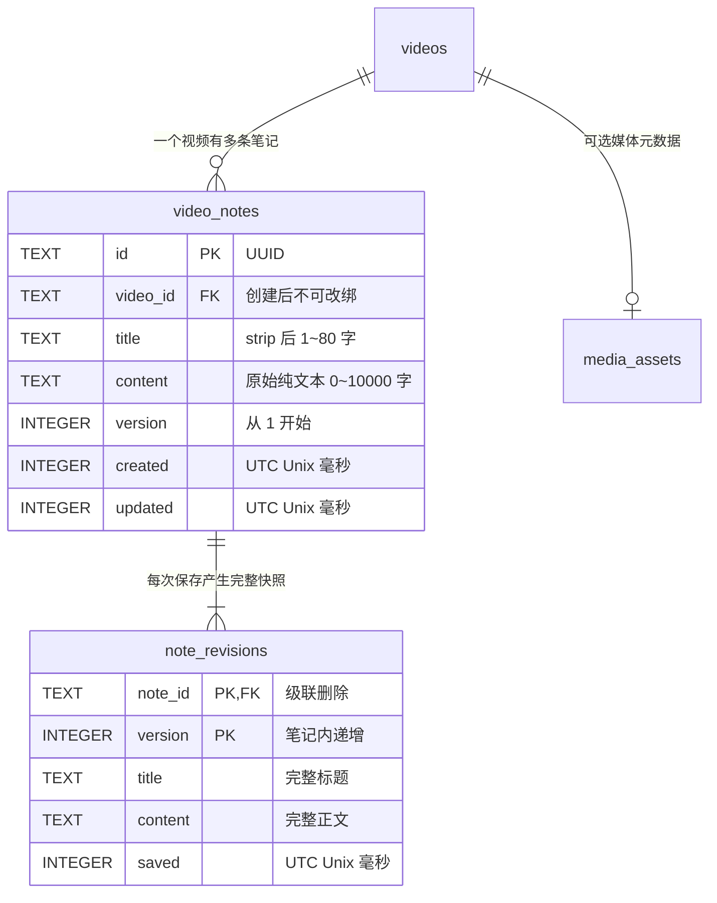
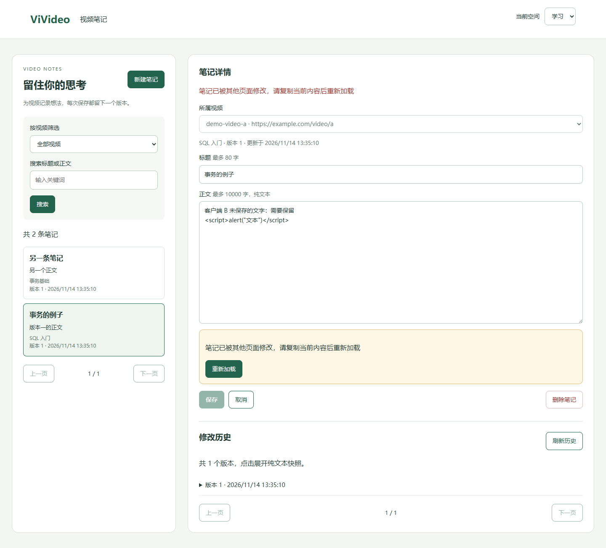

# Part B：视频笔记实现结果

独立页面：`/static/part-b.html`。使用当前空间的 `space.db` 持久化笔记，不依赖模型、下载服务或 Part A/C。公共代码仅在 `app.py` 导入并注册 `notes_router`；原有页面与入口保持原状。

## 数据关系与约束



- `notes_store.ensure_schema(db)` 逐条执行需求指定的两张表和两个索引的 DDL，可重复调用，不隐式提交已有事务。
- `video_notes.id` 为字符串 UUID；`video_id` 引用已有视频，标题允许重复。视频标题实时 JOIN，不复制到笔记表。空标题或缺失媒体记录回退到视频 ID；清理缓存不影响笔记。
- `note_revisions` 以 `(note_id, version)` 为复合主键，包含当前版本。外键 `ON DELETE CASCADE` 只清理被删除笔记的快照。
- 各空间使用 `storage.database(space)`，不增加 `space_id` 列或独立数据库。学习和漫游可有相同视频 ID，但笔记与历史互相隔离。
- API 模型禁止额外字段，正文必须显式传入且不去空白。标题先去首尾空白；版本必须为整数且至少为 1。非法空间、UUID、长度与分页返回 422，业务错误沿用 `StateError`。

## 搜索与分页 SQL

根据参数是否存在组合条件；所有用户输入通过绑定参数传递。字面子串搜索不把 `%`、`_` 当作通配符。视频筛选与关键词采用 AND。

```sql
-- 有 video_id 且关键词非空时；没有对应参数则省略相应条件。
SELECT count(*)
FROM video_notes n
JOIN videos v ON v.id = n.video_id
LEFT JOIN media_assets a ON a.video_id = v.id
WHERE n.video_id = ?
  AND (instr(n.title, ?) > 0 OR instr(n.content, ?) > 0);

SELECT n.id, n.video_id,
       COALESCE(NULLIF(a.title, ''), v.id) AS video_title,
       n.title, n.version, n.created, n.updated,
       substr(n.content, 1, 80) AS excerpt
FROM video_notes n
JOIN videos v ON v.id = n.video_id
LEFT JOIN media_assets a ON a.video_id = v.id
WHERE n.video_id = ?
  AND (instr(n.title, ?) > 0 OR instr(n.content, ?) > 0)
ORDER BY n.updated DESC, n.id ASC LIMIT ? OFFSET ?;

SELECT note_id, version, title, content, saved
FROM note_revisions WHERE note_id = ?
ORDER BY version DESC LIMIT ? OFFSET ?;
```

计数与分页读取处于同一个读事务中，`total` 是过滤后的全部数量。笔记列表不返回全文，只提供前 80 字的 `excerpt`；版本列表返回完整快照。两者均使用 `{items,total,limit,offset}`。

## 原子保存与冲突处理

创建在 `BEGIN IMMEDIATE` 后检查视频归属，再插入笔记及版本 1，同一连接一起提交。

修改先取得写锁，再以客户端打开笔记时记住的版本执行：

```sql
UPDATE video_notes
SET title = ?, content = ?, version = version + 1, updated = ?
WHERE id = ? AND version = ?;
```

`rowcount = 0` 时检查当前空间是否存在该笔记：不存在为 404，存在为 409。成功时读取新版本并插入完整快照，然后提交；即使正文相同，也增加版本。SQLite 写锁串行化并发写入，版本条件阻止旧页面覆盖新内容。

页面保存冲突后保留标题、正文和原版本，禁止继续保存，提示复制后重新加载。重新加载前有未保存内容时仍需页面内确认。网络失败保留输入并允许重试；不预先读取新版本、不自动覆盖。列表、详情、视频和历史请求分别核对请求序号、所属空间及笔记，迟到响应不能写入新的页面状态。

切换笔记、切换空间、新建、取消和删除均提供相应的未保存内容/删除确认。保存或删除期间禁止重复操作。标题、正文和历史只通过 `textContent` 或表单 `value` 展示，脚本、引号和换行作为文本保留。笔记数据从服务端读取，不使用 LocalStorage。

## 验收与测试结果

基础测试命令（临时目录、无外网请求）：

```bash
python -m unittest discover -s tests -p 'test_notes.py' -v
```

默认执行 15 项后端/接入测试，4 项浏览器测试按需启用。安装项目开发依赖和 Chromium 后可完整验收：

```bash
python -m pip install -e '.[dev]'
python -m playwright install chromium
VIVIDEO_NOTES_BROWSER=1 python -m unittest discover -s tests -p 'test_notes.py' -v
```

可用 `VIVIDEO_BROWSER_BIN` 指定已有 Chromium 系浏览器；设置 `VIVIDEO_NOTES_SCREENSHOT=docs/desgin/assets/partB-conflict.png` 可在双页面冲突用例中重新生成截图。测试用例在临时库写入需求指定的两个视频元数据，不访问它们的示例 URL；浏览器仅访问本地临时 HTTP 服务。

| 验收项 | 验证结果 |
|---|---|
| 同视频同名多笔记，重新连接及刷新后持久化 | 通过 |
| 创建版本 1、连续保存至版本 3、完整快照与历史分页 | 通过 |
| 旧客户端返回 409、两个并发写入仅一个成功 | 通过 |
| 修改后快照失败时回滚；创建快照失败也无残留 | 通过 |
| 标题去空白、空正文、长度边界、额外字段、非法版本/UUID/分页/空间 | 通过 |
| 标题/正文搜索、字面通配符、视频 AND 筛选、稳定排序及总数 | 通过 |
| 删除级联清空版本，视频及其他笔记不受影响 | 通过 |
| 不存在的视频不能创建，跨空间读取/修改/删除返回 404 | 通过 |
| 媒体标题实时读取、空标题回退、缓存清理后笔记仍在 | 通过 |
| SQL 与脚本注入文本、引号、换行保留并安全展示 | 通过 |
| 双页面冲突及网络失败保留输入、重新加载确认 | 通过 |
| 取消笔记/空间切换保留编辑器、迟到详情不覆盖当前笔记或空间 | 通过 |
| 新建/删除/历史界面、空库禁用新建、390px 窄屏无横向溢出 | 通过 |

本次启用浏览器验收后 **19 项全部通过**（15 项后端及接入、4 项无头 Chromium 系浏览器验收）。另运行现有网关测试 3 项全部通过，观看累计 JavaScript 测试通过。

现有视频库回归测试 13 项中 12 项通过，`test_cancelled_subprocess_is_terminated_and_does_not_publish` 在原生 Windows 上因既有下载器调用 POSIX `os.killpg` 失败；本次未修改下载器。项目完整运行仍按 README 使用 Linux/macOS 或 Windows WSL，未将原生 Windows 的模块验收等同于完整下载流水线验证。

### 回滚注入方法

`test_snapshot_failure_rolls_back_create_and_update` 在临时库建立 `BEFORE INSERT ON note_revisions` 触发器，以 `RAISE(ABORT, ...)` 模拟实际快照写入失败。更新已在同一事务中执行，但失败后重新打开连接读到原笔记、原版本及原历史；创建失败也没有新增笔记或快照。`test_schema_idempotent_does_not_commit_existing_transaction` 另验证重复执行建表不会破坏事务回滚。

### 双页面冲突截图

两个页面均打开版本 1；A 保存为版本 2 后，B 携带版本 1 保存失败。截图展示 B 的原版本、仍在输入框中的未保存文字、冲突提示、禁用的保存按钮和重新加载入口。历史与列表显示 B 上次加载的内容，明确重新加载或刷新历史才更新。


